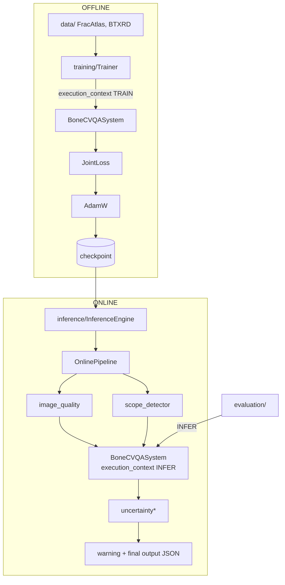

# bone_cvqa — Baseline tối giản cho CVQA X-quang xương

Baseline "basic nhất" để **test từng thành phần** của pipeline (luận văn: CVQA tin cậy trên ảnh X-quang xương dựa trên Bone Disease Ontology).

- Vision: **ResNet50** · Question: **BERT** · Fusion: **cross-attention** · Decoder: **LLM mã nguồn mở** (mặc định Qwen2.5-0.5B-Instruct)
- Placeholder (log `[TODO]`): lesion localization, ontology, entity linking, uncertainty/confidence, heatmap/evidence graph/explanation
- Dataset: FracAtlas, BTXRD (tiền xử lý cơ bản) · Metric: exact match, token F1, ROUGE-L, yes/no accuracy
- Không có xAI, không dùng API trả phí, không tự tải model/dataset.

## Flow

Entry points: `scripts/train.py` → `training.pipeline.OfflinePipeline`; `scripts/infer.py` → `inference.run` → `InferenceEngine` → `OnlinePipeline`; `scripts/evaluate.py` → `evaluation.evaluator`.

## Cài đặt
```bash
pip install -r requirements.txt && pip install -e .
```

## Lệnh
```bash
# End-to-end trên dữ liệu tổng hợp + model nhỏ ngẫu nhiên (CPU, không tải gì; chỉ kiểm tra đường ống)
python scripts/run_end2end.py --workdir outputs/end2end

# Train (Offline) — sửa đường dẫn dataset trong configs/data.yaml hoặc --set
python scripts/train.py --set data.datasets.fracatlas.root=/path/FracAtlas train.epochs=5

# Evaluate
python scripts/evaluate.py --checkpoint checkpoints/exp01/best.pt --split test

# Inference (Online)
python scripts/infer.py --checkpoint checkpoints/exp01/best.pt --image xray.png --question "Is there a fracture?"

# Test
pytest -q
```

## Mỗi module chạy độc lập
```bash
python -m bone_cvqa.image_processing.run     --image xray.png --until vision_encoder
python -m bone_cvqa.question_processing.run  --question "Is there a fracture?"
python -m bone_cvqa.ontology_processing.run
python -m bone_cvqa.cross_modal_fusion.run
```
Mỗi module cũng được `BoneCVQASystem` gọi qua `pipeline.py` của nó.

## Thay model (ablation)
Sửa `configs/model.yaml`:
```yaml
external_models:
  vision_encoder:   {provider: torchvision,  name: resnet50,                 device: cuda, enabled: true}
  question_encoder: {provider: huggingface,  name: bert-base-uncased,        device: cuda, enabled: true}
  medical_llm:      {provider: huggingface,  name: Qwen/Qwen2.5-0.5B-Instruct, device: cuda, enabled: true}
```
Provider có sẵn: vision `torchvision|open_clip|huggingface|tiny_random`; text `huggingface|pubmedbert|tiny_random`; llm `huggingface|local|medgemma|tiny_random` (`llava_med`, `api` là placeholder). Thêm model mới: kế thừa `BaseModelAdapter` (`load/predict/unload`) và `@register_adapter(role, provider)`.

## Cấu trúc
Bám sát diagram: `image_processing/`, `question_processing/`, `ontology_processing/`, `cross_modal_fusion/`, `answer_generation/`, `uncertainty_estimation/` (Online), `trustworthy_verification/` (Online), `training/` (Offline), `inference/` (Online). Chi tiết: `docs/`.
Bổ sung ngoài cây bạn đưa ra: `data/`, `evaluation/`, `external_models/` đặt ở cấp package, `checkpoint_io.py` dùng chung (để Online không import `training`).

## Trạng thái kiểm chứng & hạn chế
- `pytest`: 22 test pass (CPU, model nhỏ ngẫu nhiên): adapter, image/question/ontology, fusion+decoder, data, online không đổi tham số/không grad, Offline không import module Online-only và ngược lại, end2end.
- **Chưa kiểm chứng** với trọng số thật ResNet50/BERT/Qwen (sandbox không truy cập được HuggingFace) và dataset thật FracAtlas/BTXRD; adapter `biomedclip` chưa chạy với weights thật.
- Chỉ loss `answer` đang hoạt động; localization/rationale/knowledge-graph/alignment bị bỏ qua có ghi lý do.
- QA là weak supervision sinh từ template, không phải ground truth chuyên gia.
- Uncertainty/confidence/ontology chỉ là placeholder, không có giá trị giả.
