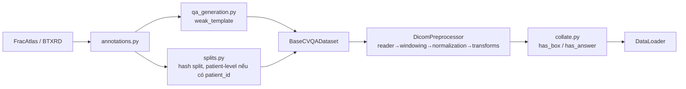

# Data pipeline

- QA sinh từ template được gắn nhãn `template_weak_supervision` (không phải ground truth chuyên gia).
- Không có bbox → `has_box=False` (ghi rõ "missing", không bịa).
- Không tự tải dữ liệu: đặt đường dẫn trong `configs/data.yaml`.
