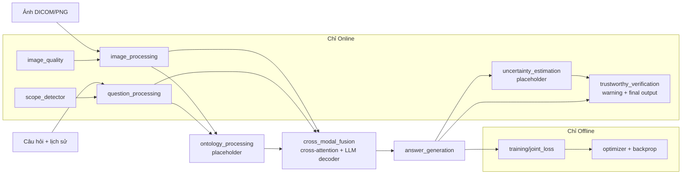

# Kiến trúc hệ thống

Offline và Online **dùng chung** `BoneCVQASystem` (`src/bone_cvqa/system.py`). Khác biệt chỉ là chế độ chạy và các thành phần riêng từng giai đoạn.

| Thành phần | Offline | Online |
|---|---|---|
| image_processing (DICOM, vision encoder, localization*, RoI, global) | ✔ | ✔ |
| question_processing (language encoder, entity linking*, type prompt) | ✔ | ✔ |
| ontology_processing* | ✔ | ✔ |
| cross_modal_fusion + LLM decoder, answer_generation | ✔ | ✔ |
| image_quality, scope_detector | ✘ | ✔ |
| uncertainty_estimation*, trustworthy_verification | ✘ | ✔ |
| joint_loss, optimizer, backprop, checkpoint save | ✔ | ✘ |

`*` = placeholder, ghi log `[TODO] ... is a placeholder`.

## Gradient
`commons/execution_mode.py::execution_context(module, mode)` là điểm duy nhất quyết định:
TRAIN → `module.train()` + `enable_grad`; INFER → `module.eval()` + `inference_mode`.

## Model ngoài (ablation)
`external_models/` + mục `external_models` trong `configs/model.yaml`. Mỗi model implement `BaseModelAdapter` (`load/predict/unload`), đăng ký theo `(role, provider)`.
