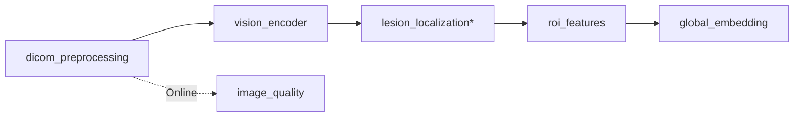

# image_processing

| Thư mục | Vai trò | Trạng thái |
|---|---|---|
| dicom_preprocessing | đọc, windowing, chuẩn hoá, resize | thật |
| image_quality | sharpness/contrast/noise (heuristic) | thật, Online-only |
| vision_encoder | ResNet50 (adapter) + projection | thật |
| lesion_localization | head/heatmap/bbox/loss | placeholder |
| roi_features | pooling theo box (skipped nếu không có box) | thật |
| global_embedding | pooling + projector | thật |

Chạy độc lập: `python -m bone_cvqa.image_processing.run --image xray.png --until vision_encoder`
